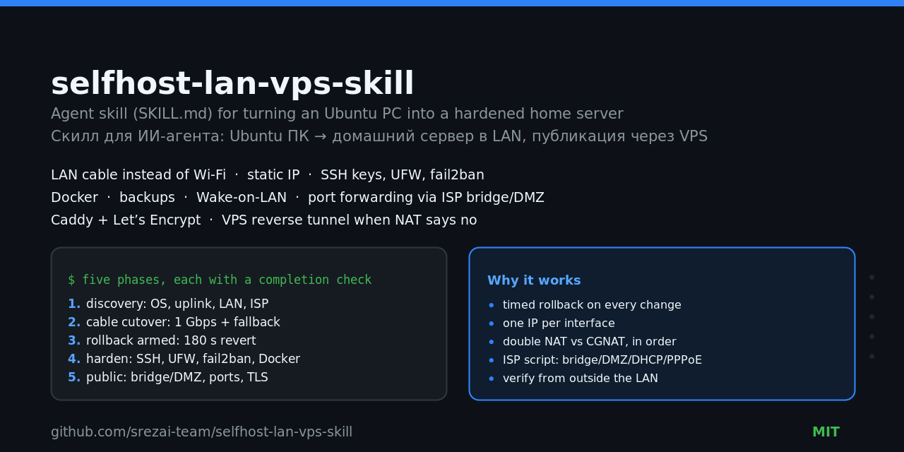

# selfhost-lan-vps-skill

**Turn a plain Ubuntu PC into a hardened self-hosted server behind a home router — and, when NAT says no, expose it through a VPS.**
**Скилл для ИИ-агента: превращает обычный Ubuntu ПК в домашний сервер в локальной сети, а при двойном NAT — публикует его через VPS.**

[](LICENSE)
[](#quick-start)
[](#requirements)
[](#quick-start)



An agent skill that turns "my Ubuntu PC should become a server, and I want to reach it from the internet" into a repeatable, reversible procedure — including the part no script can do alone: a non-technical owner plugs in a cable, enters the BIOS, and calls their ISP with a ready-made script.

Written from a real migration (mini-PC → home server), not from theory. Every trap in [`references/pitfalls.md`](references/pitfalls.md) cost real time during that migration.

---

## Why this skill exists

Most "Ubuntu home server" guides stop at `apt install`. The hard parts are elsewhere:

1. **Wi-Fi → cable is a cutover, not a setting.** Same IP on two interfaces silently breaks routing and tunnels.
2. **You can lose your own access mid-change.** Every network edit here is wrapped in a backup and a timed rollback.
3. **`traceroute` lies about double NAT.** A private hop is often the ISP's management network; only the router's WAN address decides.
4. **The public IP may not be on your router.** ISP terminal in router mode = two NATs; you need a bridge or DMZ, which means a phone call.
5. **Router web panels lock out.** Login is case-sensitive, failed attempts trigger a cooldown, and the default password may be gone — while SSH to the router still works.
6. **Docker bypasses UFW.** A published container port is open to the internet even when `ufw` says deny.
7. **Verification from inside lies.** Without NAT loopback, only a request from a *different* network proves external access.

This skill encodes those ordering rules, decision tables and completion checks so an agent does not rediscover them on a client's machine.

## What it does — five phases with completion criteria

| Phase | Outcome | Done when |
|---|---|---|
| **0. Discovery** | OS, kernel, uplink, LAN subnet, DHCP pool, router access, ISP facts, target services | Facts table filled for every field |
| **1. Cable (human)** | Provider device → router WAN, server → router LAN, 1 Gbps link | `1000Mb/s`, `Full`, `Link detected: yes` |
| **2. Network cutover** | Static LAN address, Wi-Fi as fallback on a **different** address + metric 700, ARP-flux guarded, rollback armed | One default route via cable, DNS resolves, expected public IP, fallback answers, rollback cancelled |
| **3. Hardening** | SSH keys only, UFW deny-by-default, fail2ban, unattended-upgrades, sysctl, journald limits, Docker log limits, backups, heartbeat, WoL/BIOS | Every checklist item PASS, password login refused from another host |
| **4. External access (optional)** | NAT topology identified, ISP bridge/DMZ, port forwarding, DNS, Caddy + Let's Encrypt — or VPS + reverse tunnel | `curl -I https://<domain>` from an external host returns the expected code |
| **5. Handover** | `SERVER-STATUS.md`, `SERVER-HANDOFF.md`, `SERVER-HISTORY.md`, `SERVER-NEXT-STEPS.md` + 6-line summary | Docs written, owner got the summary, no command dump |

## Who it's for

- **Homelab owners** who moved to a mini-PC and want n8n, Home Assistant, a file server or a dashboard reachable from outside — safely.
- **Small offices** where one Ubuntu box must host a couple of services behind the office router.
- **Agents working with a client remotely**: the client has physical access and a phone; the agent has SSH. This skill defines that protocol, including the exact ISP support script.
- **Anyone who hit "port forwarding does not work"** and needs to distinguish double NAT, CGNAT, a blocked port and a missing firewall rule in the right order.

## Quick start

```bash
# install the skill into your agent's skills directory
git clone https://github.com/srezai-team/selfhost-lan-vps-skill.git \
  ~/.dsh/skills/selfhost-lan-vps-skill

# or, for other runtimes that load SKILL.md skills:
#   ~/.claude/skills/selfhost-lan-vps-skill
#   ~/.config/agents/skills/selfhost-lan-vps-skill
```

Then ask the agent in plain language:

> "Turn my Ubuntu PC into a home server: connect it by cable instead of Wi-Fi, harden it, and make my app reachable over HTTPS."

> «Сделай из моего Ubuntu ПК домашний сервер: подключи по кабелю вместо Wi-Fi, защити и вывеси мой сервис по HTTPS.»

The skill fires on those intents (see the `description` in [`SKILL.md`](SKILL.md)); you can also invoke it by name.

## Division of labor: agent vs human

| Agent (SSH / local shell) | Human (physical + phone) |
|---|---|
| Discovery, netplan/NM, rollback guard, hardening, Docker, Caddy, verification from an outside vantage point | Plug the patch cord, enter BIOS (power-on after outage, Wake-on-LAN, UMA frame buffer), log into the router, call the ISP |
| Writes the ISP call script and interprets the answer | Reads the script, asks 6 questions, reports back in one line |
| Verifies each claim instead of trusting it | Confirms physical state after each step |

The ISP script in [`references/client-protocol.md`](references/client-protocol.md) covers the answers that actually change the plan: **bridge vs router mode, DHCP vs PPPoE, static IP preserved, 80/443 not blocked, CGNAT**. Each answer maps to a concrete next action.

## Safety model

- **Timed rollback before every network change** — `systemd-run --on-active=180` restores the previous config unless the change is confirmed.
- **Apply detached** — an IP change kills SSH; the operation must survive the disconnect.
- **One address per interface** — the fallback channel gets its own address and a higher metric.
- **Verify external access from outside** — a third host, not `curl` on the server itself.
- **Secrets belong in the owner's password manager**, never in generated docs.
- **Never restart the router's firewall wholesale** — apply only the generated delta, or you lose NAT together with your own access.

## Real-world run (what this was built from)

A Ryzen 7 mini-PC on Ubuntu: Wi-Fi was the only uplink, and the owner wanted public HTTPS.

- Cutover to a 1 Gbps cable with a fallback Wi-Fi profile on a second address — measured **494 Mbit/s** over cable vs **491** over Wi-Fi (ISP cap ~500), but **0.6 ms** to the router vs **3.8 ms** with 44 ms spikes, which is what actually breaks tunnels and monitoring.
- "Double NAT" suspicion from a private traceroute hop turned out to be the ISP's management network — the router's WAN address proved a single NAT.
- The ISP confirmed bridge mode + DHCP; the DHCP reservation pinned the server address.
- Port forwarding was applied on an embedded Linux router through its config system, **without restarting the firewall** (a restart would have cut the agent's own tunnel).
- Caddy + Let's Encrypt served the first page over HTTP from the internet within the same session; HTTPS followed once DNS pointed at the public IP.

The full trap catalogue — including router login lockout, tunnel port lingering and Docker/UFW conflicts — is in [`references/pitfalls.md`](references/pitfalls.md).

## Repository layout

```
selfhost-lan-vps-skill/
├── SKILL.md                      # core: rules, five phases, completion criteria
├── references/
│   ├── client-protocol.md        # owner questions, physical steps, ISP call script, glossary
│   ├── network-cutover.md        # dual-homing, netplan/NM templates, rollback, checks
│   ├── hardening.md              # 13 hardening groups with PASS criteria
│   ├── external-access.md        # NAT topology, bridge/DMZ, port forwarding, Caddy+TLS, VPS fallback
│   ├── pitfalls.md               # symptom → cause → fix, from real failures
│   └── handover-docs.md          # STATUS / HANDOFF / HISTORY / NEXT-STEPS templates
├── scripts/
│   ├── netplan-cutover.sh        # static LAN address with a 180-second auto-rollback
│   └── verify.sh                 # PASS/FAIL baseline check, non-zero exit on failures
├── examples/
│   └── wive-ng-port-forwarding.md
├── CHANGELOG.md
└── LICENSE
```

## Requirements

- **Ubuntu 22.04+** (netplan / systemd). Other Debian-family systems work with adaptation — the references mark where.
- Shell access for the agent (SSH key or local terminal). Without it, the skill runs in "instructions only" mode: copy-paste blocks and output checks.
- For a public service: an ISP that can bridge its terminal (or DMZ), **or** a small VPS for the tunnel fallback.
- Router configuration is described generically, plus one worked example for embedded Linux routers (Wive-NG-style nvram config).

## Limitations (honest list)

- Router GUIs differ; the skill targets the *procedure*, not one vendor's screenshots.
- CGNAT cannot be port-forwarded at all — the skill switches to the VPS + reverse-tunnel path instead of pretending otherwise.
- BIOS keys and menu names vary by vendor; the skill names the settings (power-on after loss, Wake-on-LAN, ErP, UMA frame buffer) rather than pretending there is one path.
- The skill configures a baseline, not a full production platform: no monitoring stack, no secrets management, no container orchestration beyond Docker Compose.

## FAQ

**How do I connect my Ubuntu PC to the router with an Ethernet cable instead of Wi-Fi?**
Plug the patch cord into a router LAN port and the PC's Ethernet port, confirm a 1 Gbps link with `ethtool`, then move the static address to the cable interface while keeping Wi-Fi as a fallback on a *different* address with a higher route metric. The step-by-step, including the timed rollback, is in [`references/network-cutover.md`](references/network-cutover.md).

**Why can't I reach my home server from the internet even after port forwarding?**
Usually one of four things, in this order: the public IP is not on your router (ISP terminal in router mode = double NAT), CGNAT, the provider blocks inbound 80/443, or the service is not listening / blocked by the host firewall. The skill decides between them from the router's WAN address rather than from `traceroute`, then verifies from an external host.

**How do I tell double NAT from CGNAT?**
Check the router's WAN address: a private WAN address behind an ISP device means double NAT (solved by bridge/DMZ); an address from the carrier-grade `100.64.0.0/10` range shared across customers means CGNAT (port forwarding impossible, use a VPS tunnel).

**How do I get HTTPS for a home server without paying?**
Point an A record at your public IP and let Caddy obtain a Let's Encrypt certificate automatically — after inbound port 80/443 actually reach the server. If they cannot, the skill falls back to DNS-01 or a VPS reverse proxy.

**How much time does hardening a fresh Ubuntu server take?**
The checklist in [`references/hardening.md`](references/hardening.md) is roughly 20–30 minutes: SSH keys only, UFW deny-by-default, fail2ban, unattended upgrades, sysctl, journald limits, Docker log limits, backups, heartbeat monitoring.

**Is it safe to let an AI agent configure my server?**
The skill is built around reversibility: backups before changes, timed auto-rollback for network edits, verification from an independent vantage point, and secrets kept out of generated documents. Still review the plan before the first phase — the agent is instructed to ask for the service list and to work only within it.

## Keywords

`home server` · `self-hosted` · `Ubuntu server setup` · `homelab` · `LAN` · `Ethernet instead of Wi-Fi` · `static IP` · `netplan` · `UFW` · `fail2ban` · `SSH hardening` · `Docker` · `port forwarding` · `double NAT` · `CGNAT` · `Wake-on-LAN` · `Caddy` · `Let's Encrypt` · `reverse SSH tunnel` · `agent skill` · `SKILL.md` · `AI agent automation`

---

## По-русски

### Что это

Скилл для ИИ-агента: превращает обычный Ubuntu ПК в домашний или офисный сервер в локальной сети — и, если снаружи до него не достучаться из-за двойного NAT, публикует сервис через VPS и обратный туннель. Работа идёт **в паре с владельцем**: агент настраивает машину по SSH, владелец подключает кабель, заходит в BIOS и звонит провайдеру по готовому скрипту.

### Для кого

- Домашняя лаборатория: n8n, Home Assistant, файлы, дашборды — доступные снаружи и защищённые.
- Небольшой офис: один Ubuntu-сервер за офисным роутером.
- Агент работает с клиентом удалённо: у клиента руки и телефон, у агента — SSH и этот протокол.
- Владелец уже пробовал «проброс портов», но не понял, почему не работает: двойной NAT, CGNAT, блокировка порта или firewall.

### Что делает (5 фаз)

1. **Разведка** — ОС, ядро, аплинк, LAN, DHCP-пул, роутер, данные провайдера, список сервисов.
2. **Кабель** (владелец) — терминал провайдера в WAN роутера, сервер в LAN; линк 1 Гбит.
3. **Переключение сети** — статический адрес, Wi-Fi резервом на другом адресе, защита от дубля IP, откат через 180 секунд.
4. **Защита** — SSH только по ключам, UFW, fail2ban, автообновления, sysctl, лимиты логов, Docker-логи, бэкапы, heartbeat, Wake-on-LAN/BIOS.
5. **Внешний доступ** — топология NAT → мост/DMZ провайдера → проброс портов → DNS → Caddy + Let's Encrypt (или VPS + туннель).
6. **Сдача** — паспорт сервера, handoff, журнал решений, чек-лист ручных шагов и короткое резюме владельцу.

### Почему ему можно доверить

- Перед каждой сетевой правкой — бэкап и **отложенный откат** (`systemd-run --on-active=180`), поэтому доступ не теряется.
- Правило «один адрес — один интерфейс»: дубль IP на кабеле и Wi-Fi больше не ломает маршрутизацию.
- Внешний доступ проверяется **снаружи**, а не с того же хоста.
- Провайдеру задаются правильные вопросы: мост/DMZ, DHCP/PPPoE, сохраняется ли статический IP, не блокируются ли 80/443, не CGNAT ли это. Каждый ответ ведёт к конкретному действию.
- Отдельный справочник ловушек: `traceroute` врёт про двойной NAT, панель роутера блокируется после неверных паролей, перезапуск firewall рвёт доступ, Docker обходит UFW, BIOS отдаёт память под iGPU.

### Установка

```bash
git clone https://github.com/srezai-team/selfhost-lan-vps-skill.git \
  ~/.dsh/skills/selfhost-lan-vps-skill
```

Дальше достаточно попросить агента словами: «сделай из моего Ubuntu ПК домашний сервер, подключи по кабелю вместо Wi-Fi и вывеси сервис по HTTPS».

### Ограничения

Роутеры у всех разные — скилл описывает процедуру, а не скриншоты одного вендора. CGNAT не «пробивается» пробросом: в этом случае скилл честно переключается на VPS. BIOS-пункты названы по смыслу (автозапуск после потери питания, Wake-on-LAN, ErP, размер видеопамяти), потому что расположение меню зависит от вендора.

### Стек и проверки

`SKILL.md` + 6 справочников + 2 bash-скрипта (`netplan-cutover.sh` — переключение с автооткатом, `verify.sh` — PASS/FAIL-проверка baseline). Скрипты проверены `bash -n` и прогнаны в контейнере; `netplan-cutover.sh` требует живой сети и применяется на реальной машине.

## Contributing

Issues and PRs are welcome — especially real trap reports: a symptom, the cause you found, and the fix. Add new pitfalls to [`references/pitfalls.md`](references/pitfalls.md) with the same `symptom → cause → fix` shape. Keep the skill vendor-neutral; vendor specifics go to `examples/`.

## License

[MIT](LICENSE) © 2026 srezai-team
